# redbees-modem-mcp — MCP-сервер для модема Redbees

Эта инструкция для тех, кто ни разу не ставил MCP-серверы. В ней по шагам
описано, как установить сервер `redbees-modem-mcp`, подключить его к
ИИ-ассистенту и работать с модемом Redbees обычными фразами. В конце перечислены
все инструменты сервера и что каждый из них делает.

Версия сервера: **0.5.0**. Документация и примеры внутри сервера соответствуют
прошивке модема **0.10.1**. Цены и условия подписок указаны на ноябрь 2026 года
и могут измениться: актуальные — на сайтах программ.

## Содержание

1. [Что такое MCP и зачем он нужен](#1-что-такое-mcp-и-зачем-он-нужен)
2. [Что понадобится](#2-что-понадобится)
3. [Установка сервера](#3-установка-сервера)
4. [Выбор программы-ассистента](#4-выбор-программы-ассистента)
5. [Подключение сервера к программе](#5-подключение-сервера-к-программе)
   - [OpenCode — бесплатно](#51-opencode--бесплатно)
   - [ADCode — бесплатно](#52-adcode--бесплатно)
   - [Claude Code](#53-claude-code)
   - [Codex](#54-codex)
   - [Kimi Code](#55-kimi-code)
   - [ZCode](#56-zcode)
   - [Режим HTTP: один сервер на все программы](#57-режим-http-один-сервер-на-все-программы)
6. [Первая проверка](#6-первая-проверка)
7. [Как работать с сервером](#7-как-работать-с-сервером)
8. [Подключение модема: USB, Bluetooth, сеть](#8-подключение-модема-usb-bluetooth-сеть)
9. [Список инструментов](#9-список-инструментов)
10. [Справочники и готовые сценарии](#10-справочники-и-готовые-сценарии)
11. [Обновление и удаление](#11-обновление-и-удаление)
12. [Если что-то не работает](#12-если-что-то-не-работает)
13. [Настройки сервера](#13-настройки-сервера)
14. [Словарь терминов](#14-словарь-терминов)

---

## 1. Что такое MCP и зачем он нужен

Сам по себе ИИ-ассистент умеет только отвечать текстом. Он не видит ваш модем и
не может отправить ему команду. **MCP** (Model Context Protocol) — это
стандартный способ дать ассистенту «руки»: подключить к нему программу, которая
умеет что-то делать на вашем компьютере.

В этой схеме три участника:

| Кто | Что это | Пример |
|---|---|---|
| **Модель ИИ (LLM)** | «Мозг»: понимает ваш запрос и решает, что сделать | Claude, GPT, Kimi, GLM, DeepSeek |
| **Программа-ассистент** (MCP-хост) | Программа, в которой вы общаетесь с моделью | OpenCode, Claude Code, Codex, Kimi Code, ZCode |
| **MCP-сервер** | Программа с набором **инструментов**, которые модель может вызывать | `redbees-modem-mcp` |

Вы пишете, например: «Покажи уровень сигнала модема на COM5». Модель понимает,
что для этого есть инструмент `smp_shell`, программа-ассистент запускает его
через сервер, сервер отправляет команду модему и возвращает ответ, а модель
пересказывает его вам.

Что умеет сервер `redbees-modem-mcp`:

- **писать Lua-скрипты для модема** по описанию задачи и проверять их на ошибки
  (с опорой на встроенную документацию прошивки, а не на догадки модели);
- **управлять модемом** по USB, Bluetooth или по сети: читать состояние, менять
  настройки, выполнять команды, загружать файлы и скрипты, обновлять прошивку;
- **диагностировать** модем: читать журналы, разбирать аварийные дампы,
  выяснять, почему модем завис;
- **прошивать** модем «с нуля» через esptool.

Сервер работает на вашем компьютере. Документация, примеры и база знаний уже
лежат внутри него. Интернет нужен для установки и для модели ИИ.

## 2. Что понадобится

- Компьютер с **Windows 10/11**, **Linux** или **macOS** и доступом в интернет.
- **Около 3 ГБ свободного места** на системном диске: сам сервер (~2 ГБ, в
  основном библиотека PyTorch) и поисковая модель (~1 ГБ).
- **Программа-ассистент** и доступ к модели ИИ — бесплатный или по подписке, см.
  [раздел 4](#4-выбор-программы-ассистента).
- **Модем Redbees и USB-кабель** — для работы с устройством. Писать и проверять
  Lua-скрипты можно и без модема.

> **Не перепутайте две «модели».** *Модель ИИ* — «мозг» ассистента, её выбирают
> в программе-ассистенте. *Поисковая модель* — небольшая модель, которую сервер
> использует для поиска по документации; она скачивается один раз и настройки не
> требует.

## 3. Установка сервера

Сервер ставится в **терминале** — окне для ввода команд. Это единственное место
в инструкции, где он нужен: дальше всё делается в окнах программ.

- **Windows:** меню «Пуск» → наберите `PowerShell` → откройте «Windows PowerShell».
- **Linux:** приложение «Терминал».
- **macOS:** «Программы» → «Утилиты» → «Терминал».

Скопируйте команду, вставьте её в терминал (в PowerShell — правой кнопкой мыши)
и нажмите Enter.

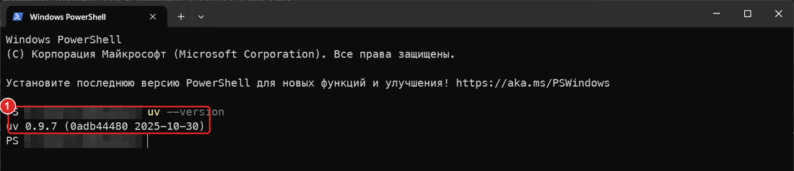

### Шаг 1. Установите uv

`uv` — небольшая программа, которая сама скачает нужную версию Python и все
библиотеки сервера. Отдельно ставить Python не нужно.

**Windows (PowerShell):**

```powershell
powershell -ExecutionPolicy ByPass -c "irm https://astral.sh/uv/install.ps1 | iex"
```

**Linux и macOS:**

```bash
curl -LsSf https://astral.sh/uv/install.sh | sh
```

После установки **закройте терминал и откройте его снова**, затем проверьте:

```bash
uv --version
```

Должна появиться строка с номером версии. Если терминал отвечает, что команда не
найдена, перезагрузите компьютер.

### Шаг 2. Установите сервер

```bash
uv tool install --python 3.12 redbees-modem-mcp
```

`--python 3.12` обязателен: без него uv может взять самый новый Python (3.13 и
выше), для которого нет библиотеки шифрования `python-mbedtls`, и установка
сорвётся. Python 3.12 uv скачает сам. В первый раз установка займёт несколько
минут. В конце появятся строки вида:

```
Installed redbees-modem-mcp
Installed 4 executables: redbees-modem-mcp, redbees-modem-mcp-download-model, ...
```

> **Linux: установка без лишних 3 ГБ.** На Linux вместе с сервером скачивается
> версия PyTorch для видеокарт NVIDIA (CUDA, около 3 ГБ), а серверу она не
> нужна: поиск по документации идёт на процессоре. Облегчённая версия ставится
> не командой `uv tool install`, а в отдельную папку:
>
> ```bash
> mkdir -p ~/redbees-modem-mcp && cd ~/redbees-modem-mcp
> uv venv --python 3.12
> UV_TORCH_BACKEND=cpu uv pip install redbees-modem-mcp
> ```
>
> Тогда в шаге 3 запускайте `~/redbees-modem-mcp/.venv/bin/redbees-modem-mcp-download-model`,
> а в настройках программы-ассистента вместо команды `redbees-modem-mcp`
> указывайте полный путь `/home/<ваше имя>/redbees-modem-mcp/.venv/bin/redbees-modem-mcp`.
> Обновление: `UV_TORCH_BACKEND=cpu uv pip install -U redbees-modem-mcp` в той же
> папке. На Windows и macOS это не нужно: там PyTorch и так ставится без CUDA.

### Шаг 3. Скачайте поисковую модель

```bash
redbees-modem-mcp-download-model
```

Дождитесь строки `Done! Model saved to: ...`. Модель скачивается один раз. Этот
шаг можно пропустить, но тогда модель начнёт скачиваться при первом запросе, и
ответа придётся ждать несколько минут.

### Шаг 4 (только Linux). Разрешите доступ к USB-порту

```bash
sudo usermod -aG dialout $USER
```

После этого выйдите из системы и войдите снова.

## 4. Выбор программы-ассистента

Сервер работает с любой программой, которая поддерживает MCP. В инструкции
описаны шесть программ с обычными окнами: две бесплатные и четыре по подписке.

| Программа | Системы | Модели | Стоимость |
|---|---|---|---|
| [OpenCode](#51-opencode--бесплатно) | Windows, macOS, Linux (бета-версия) | Бесплатные модели OpenCode (DeepSeek, GLM и др.) или любые другие по своему ключу | Бесплатно |
| [ADCode](#52-adcode--бесплатно) | Windows, Linux | Встроенные модели (Qwen, GLM, DeepSeek, MiMo) с дневным лимитом или свой ключ | Бесплатно, с рекламой; платные тарифы от $9 в месяц |
| [Claude Code](#53-claude-code) | Windows, macOS | Claude (Anthropic) | Подписка Claude Pro от $20 в месяц |
| [Codex](#54-codex) | Windows, macOS, Linux | GPT (OpenAI) | Подписка ChatGPT Plus от $20 в месяц |
| [Kimi Code](#55-kimi-code) | Windows, macOS, Linux | Kimi (Moonshot AI) | Подписка Kimi уровня Plus или выше |
| [ZCode](#56-zcode) | Windows, macOS, Linux | GLM (Z.ai) | GLM Coding Plan от $18 в месяц |

Как выбрать:

- **Попробовать бесплатно** — OpenCode или ADCode.
- **Нужна самая надёжная работа с инструментами** — Claude Code или Codex.
  Сервер даёт модели почти 50 инструментов, и сильные модели реже ошибаются в
  выборе. Учтите, что Anthropic и OpenAI официально не работают в России.

Во всех программах сервер подключается **для пользователя целиком**, а не для
одной папки, — так он доступен в любом проекте.

## 5. Подключение сервера к программе

Выберите один подраздел — тот, что соответствует вашей программе.

Во всех вариантах программе сообщают одно и то же: запускать команду
`redbees-modem-mcp` с настройкой `RB_TRANSPORT=stdio`. В ADCode, Codex и ZCode
это делается в окне настроек. OpenCode, Claude Code и Kimi Code берут
настройки из файла, который нужно один раз отредактировать в Блокноте.

Если вы работаете в нескольких программах сразу, можно запустить один общий
сервер и подключить к нему все программы по адресу, см.
[подраздел 5.7](#57-режим-http-один-сервер-на-все-программы).

> **Зачем `RB_TRANSPORT=stdio`.** Сервер умеет работать в двух режимах:
> запускаться программой-ассистентом (stdio) или работать отдельным веб-сервером
> (HTTP, [подраздел 5.7](#57-режим-http-один-сервер-на-все-программы)). Эта
> настройка гарантирует первый режим, даже если на компьютере где-то задана
> настройка для второго. Без неё программа в таком случае не дождётся ответа от
> сервера.

> **Как открыть файл настроек в Блокноте (Windows).** Нажмите `Win+R`, вставьте
> команду из подраздела вашей программы (она начинается с `notepad`) и нажмите
> Enter. Если файла ещё нет, Блокнот спросит, создать ли его: ответьте «Да».
> Вставьте текст из инструкции, сохраните (`Ctrl+S`) и закройте Блокнот. На
> macOS и Linux откройте файл по указанному пути в любом текстовом редакторе.

### 5.1. OpenCode — бесплатно

[OpenCode](https://opencode.ai) — бесплатная программа с открытым кодом. Версия
с окнами для Windows, macOS и Linux пока в статусе бета. Можно пользоваться
бесплатными моделями OpenCode или подключить свой ключ.

**Установка.** Откройте <https://opencode.ai/download>, в разделе **Desktop**
скачайте установщик для своей системы (для Windows —
`opencode-desktop-win-x64.exe`) и установите со значениями по умолчанию.

**Подключение сервера.** Закройте OpenCode, откройте файл настроек:

- Windows: `notepad %USERPROFILE%\.config\opencode\opencode.json`
- macOS и Linux: `~/.config/opencode/opencode.json`

Вставьте в него:

```json
{
  "$schema": "https://opencode.ai/config.json",
  "mcp": {
    "redbees-modem": {
      "type": "local",
      "command": ["redbees-modem-mcp"],
      "environment": {
        "RB_TRANSPORT": "stdio",
        "RB_JOB_FOREGROUND_WAIT": "25"
      }
    }
  }
}
```

Если в файле уже есть блок `"mcp": {...}`, добавьте `"redbees-modem": {...}`
внутрь него через запятую, а не второй блок `"mcp"`. `RB_JOB_FOREGROUND_WAIT`
укладывает долгие операции в ожидание OpenCode: что не успело за 25 секунд,
сервер доделает в фоне.

Запустите OpenCode и откройте рабочую папку. Проверьте подключение: на
стартовом экране нажмите **Settings** в левой панели (или `Ctrl+,`), откройте
**Extensions** и вкладку **MCPs**. Сервер `redbees-modem` должен быть в списке
с зелёной точкой и включённым переключателем.

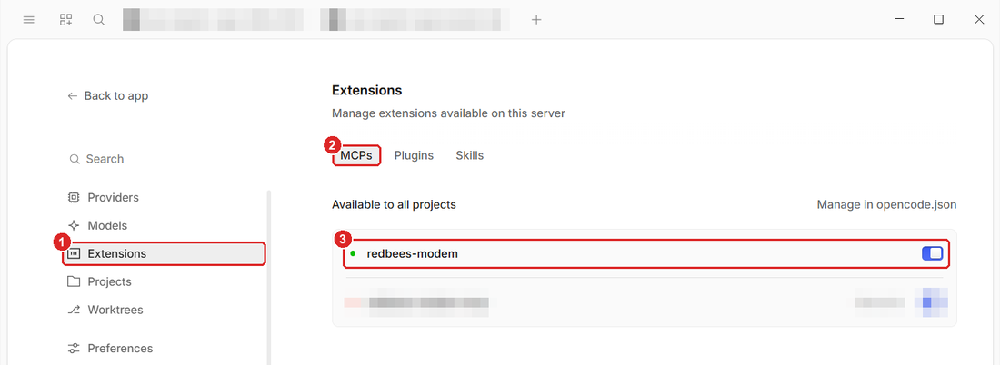

**Выбор модели.** Нажмите на название модели рядом с полем ввода сообщения и
выберите модель в списке. Бесплатные модели OpenCode помечены как Free; если
их нет в списке, войдите в аккаунт OpenCode, когда программа предложит. Для
работы с сервером лучше подходят модели, запросы к которым по условиям OpenCode
не хранятся, например DeepSeek V4.1 Flash и GLM-5.3-Flash.

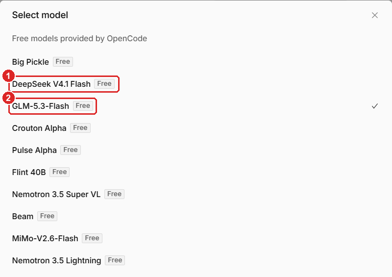

> **Бесплатные модели — не навсегда и не для секретов.** OpenCode даёт их «на
> ограниченное время», набор меняется. Запросы к некоторым из них (например,
> Big Pickle) могут использоваться для обучения модели. Не вставляйте в чат
> ключи PSK, пароли и закрытый код. Часть бесплатных моделей недоступна из
> России; если модель не отвечает, выберите другую.

Перед вызовом инструмента OpenCode может спросить разрешение: разрешить один
раз, разрешать всегда или отказать.

### 5.2. ADCode — бесплатно

[ADCode](https://adcode.bluethenics.com) — бесплатный редактор кода с
ИИ-ассистентом от Bluethenics, с открытым кодом. Работает в Windows 10/11 и
Linux; версии для macOS пока нет. Бесплатность оплачивается рекламой: в углу
окна показывается рекламная карточка. Встроенные модели (Qwen, GLM, DeepSeek,
MiMo) работают без ключа API, но с дневным лимитом запросов; платные тарифы его
увеличивают. Можно подключить и свой ключ (OpenAI, Gemini, Groq, OpenRouter).

> У ADCode есть и версия в браузере. Для модема она не подходит: сервер должен
> запускаться на вашем компьютере, а браузерная версия этого не умеет.

**Установка.** На <https://adcode.bluethenics.com> скачайте установщик для
Windows (или пакет `.deb` либо `.AppImage` для Linux) и установите. Запустите
ADCode. Для встроенных моделей нужен подтверждённый аккаунт ADCode: войдите
через Google или GitHub, когда программа предложит.

**Подключение сервера:**

1. Откройте страницу **Tools** (значок гаечного ключа на узкой панели слева или
   команда **Open Tools** в палитре команд) и перейдите на вкладку
   **Connectors**.
2. Нажмите **Add connector** и в открывшемся окне выберите вкладку **Custom
   connector** (или сразу нажмите **Add custom connector**).
3. **Name:** `redbees-modem`.
4. Раскройте **Advanced** и в поле **Connection type** выберите **Local command
   (stdio)**. Вместо поля адреса появится поле **Command**.
5. **Command:** `redbees-modem-mcp`. В **Arguments (a JSON list)** оставьте `[]`.
6. В поле **Headers or environment values** впишите две строки:
   `RB_TRANSPORT=stdio` и `RB_JOB_FOREGROUND_WAIT=25`.
7. Нажмите **Continue**. В окне **Connect redbees-modem?** нажмите **Allow
   once**: так ADCode запустит сервер.

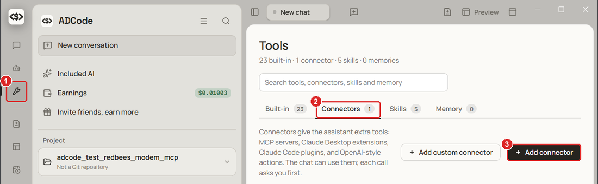
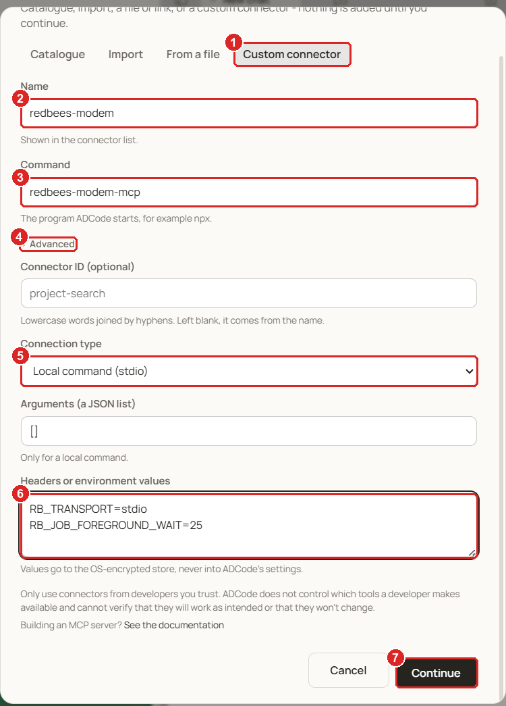

Если сервер уже подключён к другой программе (например, к Claude Code), его
можно не вводить заново: **Add connector** → **Import** → **Scan this computer**
найдёт готовые настройки.

**Проверка и включение инструментов.** На карточке `redbees-modem` должна
гореть зелёная точка и надпись **Connected**. Инструменты сервера сначала все
выключены: нажмите **Tools** на карточке и включите нужные. Если не уверены,
включите все, затем нажмите **Done**.

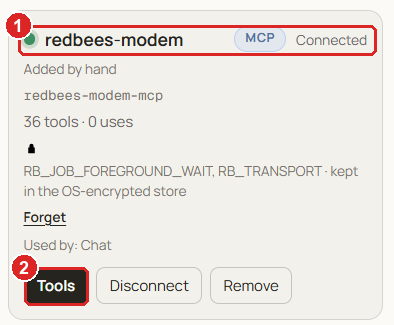

По умолчанию ADCode вызывает включённые инструменты без вопросов. Чтобы он
спрашивал перед каждым вызовом и показывал его параметры, откройте **Settings**
→ **AI** и включите **Ask before connector tools**: тогда при вызове появится
окно с кнопками **Allow once** и **Cancel**. Модем в любом случае защищён
превью сервера (см. [раздел 7](#7-как-работать-с-сервером)).

### 5.3. Claude Code

Claude Code встроен в приложение **Claude** для Windows и macOS: это вкладка
**Code**. Нужна подписка **Claude Pro** ($20 в месяц) или выше.

**Установка.** Скачайте приложение на <https://claude.ai/download>, установите,
запустите и войдите в аккаунт Claude.

**Подключение сервера.** Настройки MCP-серверов приложение хранит в файле
`claude_desktop_config.json`; вкладка Code берёт серверы из него же.

1. Откройте **Settings** → **Developer** и нажмите **Edit Config**. Откроется
   файл `claude_desktop_config.json` или папка с ним; откройте файл в Блокноте.
2. Вставьте в него:

   ```json
   {
     "mcpServers": {
       "redbees-modem": {
         "command": "redbees-modem-mcp",
         "args": [],
         "env": { "RB_TRANSPORT": "stdio" }
       }
     }
   }
   ```

   Если в файле уже есть другие настройки, добавьте блок `"mcpServers": {...}`
   рядом с ними через запятую.
3. Полностью закройте Claude, включая значок в области уведомлений, и
   запустите снова.

<!-- 📷 claude-01: Settings → Developer, кнопка Edit Config -->

**Проверка.** В **Settings** → **Developer** сервер `redbees-modem` должен быть
в списке со статусом запуска (в новых версиях приложения этот список находится
в **Settings** → **Desktop app** → **Extensions** → **Manage**, раздел **Local
MCP servers**). На вкладке **Code** нажмите **+** рядом с полем ввода и откройте
**Connectors**: там видны подключённые серверы и их инструменты.

<!-- 📷 claude-02: список серверов, redbees-modem запущен -->
<!-- 📷 claude-03: вкладка Code, меню + → Connectors с redbees-modem -->

Перед вызовом инструмента Claude спрашивает разрешение. Можно разрешить один
раз или разрешать всегда. Второе стоит выбирать только для инструментов,
которые ничего не меняют на модеме (в [разделе 9](#9-список-инструментов)
они отмечены 👁 и 📄).

<!-- 📷 claude-04: запрос разрешения на вызов инструмента redbees-modem -->

### 5.4. Codex

[Codex](https://learn.chatgpt.com/codex) — программа OpenAI для Windows, macOS
и Linux. Нужна подписка **ChatGPT Plus** ($20 в месяц) или выше.

**Установка.** Скачайте приложение по ссылке со страницы
<https://learn.chatgpt.com/codex/quickstart> (на Windows оно ставится из
Microsoft Store), установите и войдите через **Sign in with ChatGPT**. Codex
встроен в приложение **ChatGPT**: под этим именем оно и стоит в меню «Пуск».
Codex — это режим **Work** (переключатель **Chat** / **Work** вверху окна).

**Подключение сервера:**

1. Откройте настройки: меню аккаунта в левом нижнем углу → **Settings** (или
   `Ctrl+,`). В левой панели, в группе **Integrations**, выберите **Plugins** и
   перейдите на вкладку **MCPs**.
2. Нажмите **Add** → **Add MCP server**. Откроется форма **Connect to a custom
   MCP**.
3. **Name:** `redbees-modem`.
4. **Type:** **STDIO**.
5. **Command to launch:** `redbees-modem-mcp`.
6. В **Environment variables** впишите ключ `RB_TRANSPORT` и значение `stdio`.
7. Нажмите **Save**. Сервер появится в списке с включённым переключателем.

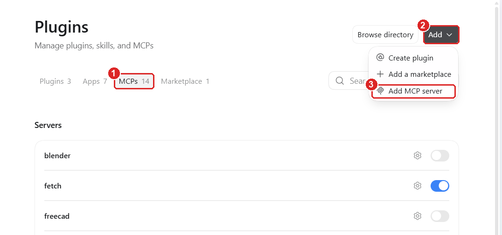
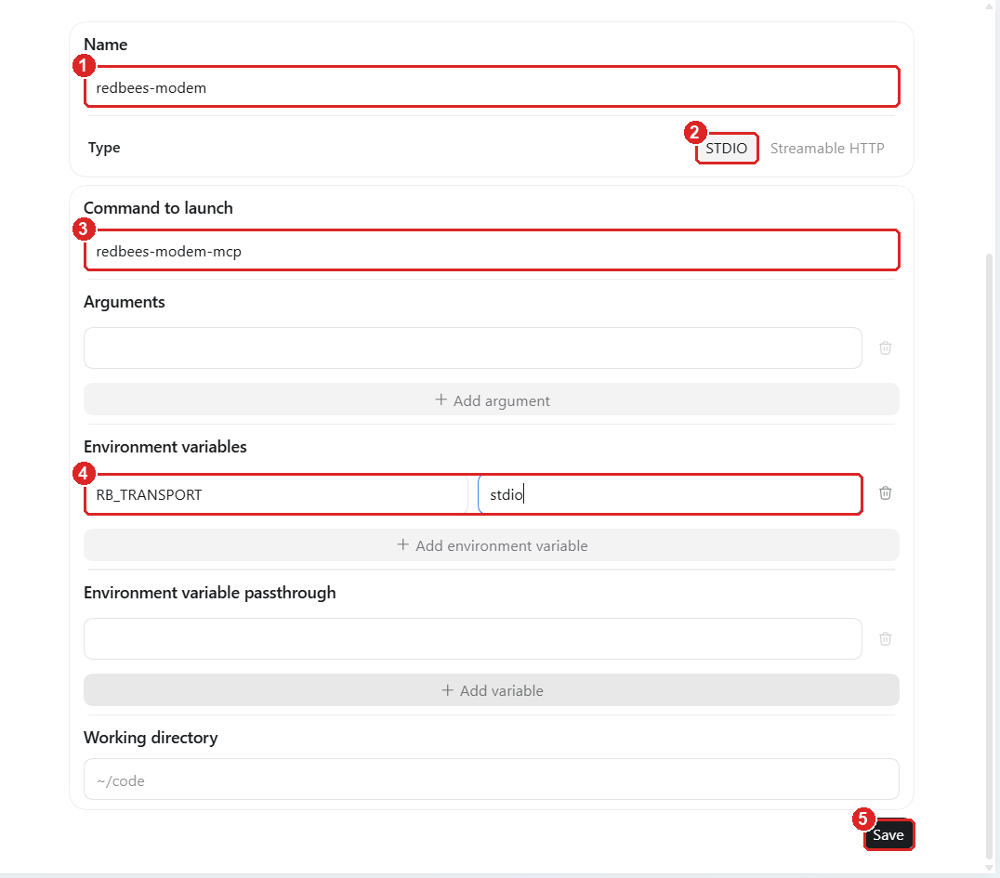

Если сервер с таким именем уже был, Codex сохранит новый под именем
`redbees-modem-2`. Старый тогда лучше выключить в том же списке.

**Допишите время ожидания в файл.** В окне Codex его не задать, а по умолчанию
Codex ждёт запуска сервера всего 10 секунд: на медленном компьютере этого может
не хватить. Закройте Codex и откройте файл его настроек:

- Windows: `notepad %USERPROFILE%\.codex\config.toml`
- macOS и Linux: `~/.codex/config.toml`

Найдите раздел `[mcp_servers.redbees-modem]`, который Codex создал на прошлом
шаге, и приведите его к такому виду:

```toml
[mcp_servers.redbees-modem]
command = "redbees-modem-mcp"
args = []
startup_timeout_sec = 60
tool_timeout_sec = 120

[mcp_servers.redbees-modem.env]
RB_TRANSPORT = "stdio"
```

Сохраните файл и запустите Codex.

**Проверка.** В режиме **Work** напишите в поле ввода `/mcp`, выберите в
подсказке **MCP — Show MCP server status** и нажмите Enter. Под полем ввода
появится список серверов: у `redbees-modem` должно быть написано **Enabled**.

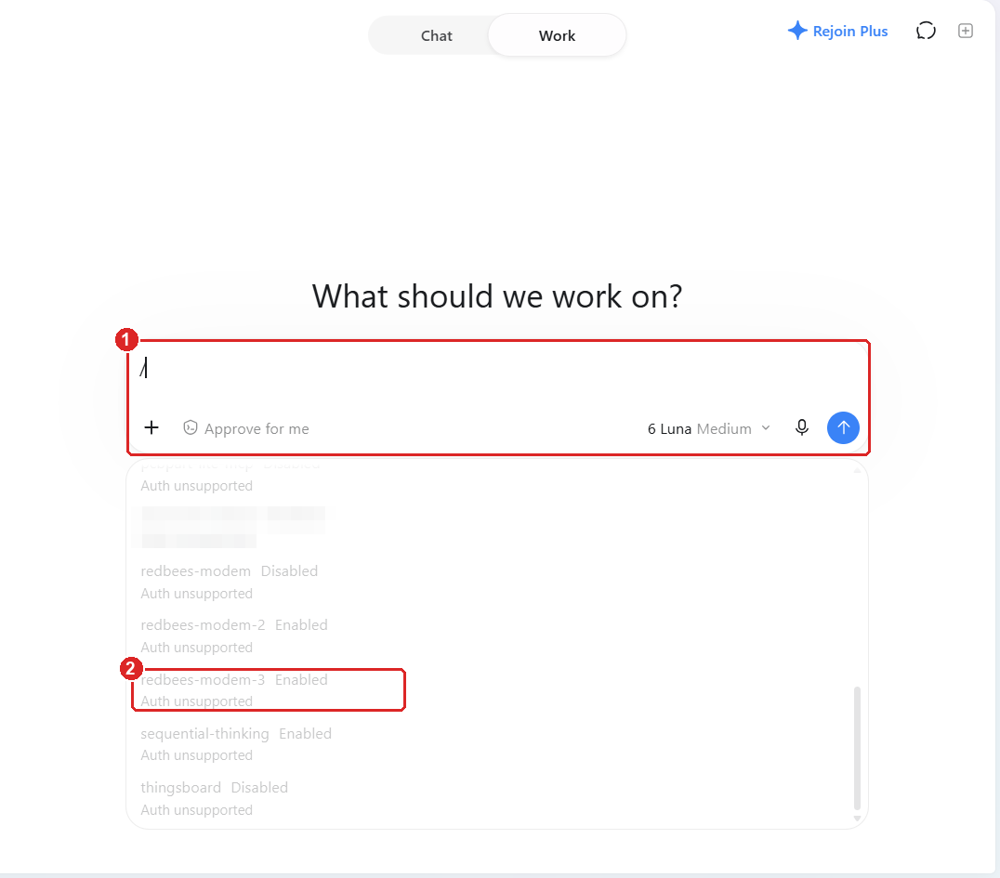

Насколько Codex самостоятельен, задаёт переключатель под полем ввода. Выберите
**Ask for approval**: тогда Codex спрашивает разрешение перед действиями. По
умолчанию там может стоять **Approve for me** — тогда Codex спрашивает только
о действиях, которые сочтёт опасными.

### 5.5. Kimi Code

[Kimi Code](https://www.kimi.com/code) — программа Moonshot AI с моделями Kimi
для Windows, macOS и Linux. Нужна подписка Kimi уровня **Plus** или выше
(уровень Go не включает Kimi Code).

**Установка.** На <https://www.kimi.com/code> скачайте приложение для своей
системы (для Windows — `KimiCode-win-x64.exe`) и установите. При первом
запуске выберите язык интерфейса и войдите в аккаунт Kimi; позже это делается
в левом нижнем углу окна.

**Подключение сервера.** Окна для добавления MCP-серверов в Kimi Code нет,
сервер прописывается в файле. Откройте его:

- Windows: `notepad %USERPROFILE%\.kimi-code\mcp.json`
- macOS и Linux: `~/.kimi-code/mcp.json`

Вставьте:

```json
{
  "mcpServers": {
    "redbees-modem": {
      "command": "redbees-modem-mcp",
      "args": [],
      "env": { "RB_TRANSPORT": "stdio" },
      "startupTimeoutMs": 60000,
      "toolTimeoutMs": 120000
    }
  }
}
```

Сохраните файл. Сервер подключается только к **новым** сессиям: начните новую
кнопкой новой сессии или командой `/new` в поле ввода.

**Проверка.** В новой сессии попросите: «Вызови инструмент smp_version». Если
сервер подключён, ассистент покажет версии библиотек связи с модемом.

<!-- 📷 kimi-01: новая сессия, ответ на «Вызови инструмент smp_version» -->

Перед действиями Kimi Code показывает карточку с кнопками одобрить или
отклонить вызов. Режим подтверждений выбирается рядом с полем ввода; оставьте
режим, в котором программа всегда спрашивает.

### 5.6. ZCode

[ZCode](https://zcode.z.ai/en) — программа Z.ai с моделями GLM для Windows,
macOS и Linux. Модели работают по подписке **GLM Coding Plan** (от $18 в месяц)
или по ключу API с оплатой за использование.

**Установка.** Скачайте установщик для своей системы на
<https://zcode.z.ai/en> и установите со значениями по умолчанию. При первом
запуске нажмите **Connect** в левом нижнем углу и войдите через **Connect Z.ai**
(или укажите ключ через **Use API Key**).

**Подключение сервера:**

1. Откройте настройки (значок шестерёнки рядом с вашим именем в левом нижнем
   углу), в левой панели выберите **MCP Servers** и нажмите **+ New** справа над
   списком серверов.
2. **Scope:** оставьте **User**, чтобы сервер работал во всех проектах.
3. **Name:** `redbees-modem`.
4. **Type:** оставьте `stdio (local command)`.
5. **Command:** `redbees-modem-mcp`, **Arguments** оставьте пустыми.
6. Раскройте **Environment variables (optional)** и вставьте в поле:

   ```json
   {
     "RB_TRANSPORT": "stdio",
     "RB_JOB_FOREGROUND_WAIT": "25"
   }
   ```

7. Нажмите **Save** и убедитесь, что сервер включён в списке: переключатель
   справа тёмный, точка у значка зелёная.

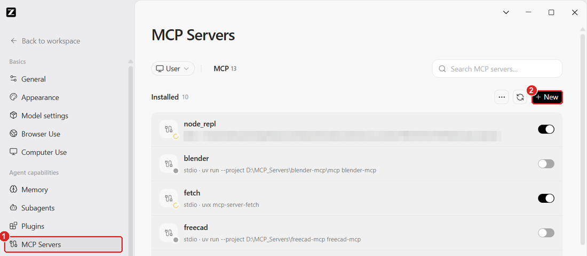
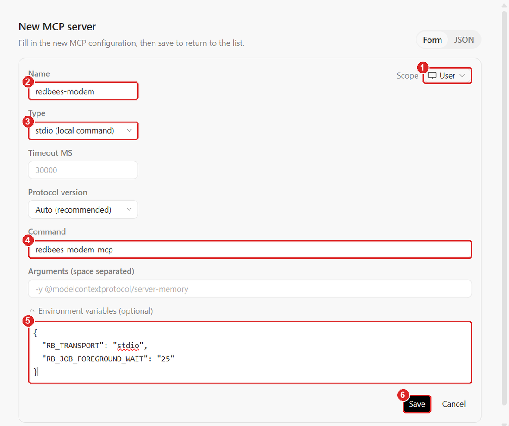
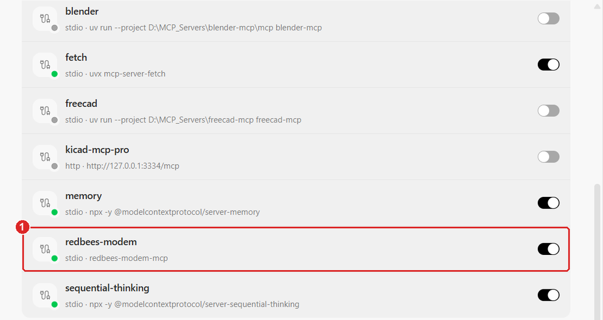

Перед действиями ZCode спрашивает разрешение: **Allow** — разрешить один раз,
**Always Allow** — разрешать всегда, **Reject** — отказать. Режим подтверждений
выбирается рядом с полем ввода; оставьте режим по умолчанию **Ask before
changes**.

### 5.7. Режим HTTP: один сервер на все программы

В подразделах выше каждая программа сама запускает свою копию сервера (режим
stdio). Это самый простой вариант, но у него есть цена: каждая копия держит в
памяти свою поисковую модель (около 1 ГБ), и при каждом запуске программы
сервер стартует заново.

В режиме **HTTP** (streamable-http) сервер запускается один раз отдельно, а
программы подключаются к нему по адресу `http://127.0.0.1:8082/mcp`.

| | stdio (подразделы 5.1–5.6) | HTTP |
|---|---|---|
| Кто запускает сервер | Программа-ассистент, сама | Вы, командой в терминале |
| Несколько программ сразу | У каждой своя копия сервера и модели | Одна копия на всех |
| Если сервер не запущен | Такого не бывает | Программа не увидит инструментов |
| Что указывать в программе | Команду `redbees-modem-mcp` | Адрес `http://127.0.0.1:8082/mcp` |

HTTP удобен, если вы работаете в двух-трёх программах одновременно или
компьютер небогат памятью. Если у вас одна программа, оставайтесь на stdio.

**Запуск сервера.** Откройте терминал (см. [раздел 3](#3-установка-сервера)) и
выполните:

- Windows (PowerShell):

  ```powershell
  $env:RB_TRANSPORT="streamable-http"; $env:RB_PORT="8082"; $env:RB_JOB_FOREGROUND_WAIT="25"; redbees-modem-mcp
  ```

- Linux и macOS:

  ```bash
  RB_TRANSPORT=streamable-http RB_PORT=8082 RB_JOB_FOREGROUND_WAIT=25 redbees-modem-mcp
  ```

Сервер готов, когда появится строка
`Uvicorn running on http://127.0.0.1:8082 (Press CTRL+C to quit)`. **Не
закрывайте это окно**, пока работаете: закрыли окно — сервер остановился.
Остановить его можно и сочетанием `Ctrl+C` в этом окне. После перезагрузки
компьютера сервер нужно запустить снова, и до запуска программы-ассистента.

`RB_JOB_FOREGROUND_WAIT=25` здесь нужен для того же, что и в OpenCode: долгие
операции отвечают в пределах 25 секунд и доделываются в фоне. Настройки сервера
в HTTP-режиме задаются только в этой команде: блоки `env` и `environment` в
программах-ассистентах на сервер больше не действуют.

**Подключение программ.** Вместо команды везде указывается адрес. Имя сервера
то же: `redbees-modem`.

- **OpenCode** — в `opencode.json` вместо блока из [подраздела 5.1](#51-opencode--бесплатно):

  ```json
  {
    "$schema": "https://opencode.ai/config.json",
    "mcp": {
      "redbees-modem": {
        "type": "remote",
        "url": "http://127.0.0.1:8082/mcp"
      }
    }
  }
  ```

- **ADCode** — **Add connector** → **Custom connector**: **Name**
  `redbees-modem`, **MCP server URL** `http://127.0.0.1:8082/mcp`. В
  **Connection type** оставьте **Remote URL (HTTP)**, переменные окружения не
  нужны.
- **Claude Code** — приложение Claude подключается к HTTP-серверу только через
  программу-переходник `mcp-remote`; для неё нужен [Node.js](https://nodejs.org).
  В `claude_desktop_config.json`:

  ```json
  {
    "mcpServers": {
      "redbees-modem": {
        "command": "npx",
        "args": ["-y", "mcp-remote", "http://127.0.0.1:8082/mcp"]
      }
    }
  }
  ```

- **Codex** — в форме **Connect to a custom MCP** выберите тип **Streamable
  HTTP** и впишите адрес. То же в файле `config.toml`:

  ```toml
  [mcp_servers.redbees-modem]
  url = "http://127.0.0.1:8082/mcp"
  tool_timeout_sec = 120
  ```

- **Kimi Code** — в `mcp.json` вместо `command`, `args` и `env`:

  ```json
  {
    "mcpServers": {
      "redbees-modem": { "url": "http://127.0.0.1:8082/mcp" }
    }
  }
  ```

- **ZCode** — в форме **New MCP server** в поле **Type** выберите HTTP вместо
  `stdio (local command)` и впишите адрес. Переменные окружения не нужны.

Проверка — та же, что для stdio: сервер `redbees-modem` включён в списке
программы, а на просьбу «Вызови инструмент smp_version» ассистент показывает
версии библиотек. Если программа пишет, что не может подключиться, проверьте,
что окно с сервером открыто и в нём нет ошибок.

> **Сервер с доступом к модему не открывают в сеть.** По умолчанию он принимает
> подключения только с этого же компьютера (`127.0.0.1`), и так и должно быть:
> кто подключится к серверу, тот может прошить и стереть модем. Доступ к модемам
> по сети для нескольких пользователей делается отдельными режимами `monitor`
> и `manage` с токенами доступа, их настраивает администратор: см.
> [подраздел 9.10](#910-парк-модемов-для-администраторов).

Если на компьютере открыт сервер в HTTP-режиме, а какая-то программа подключена
по stdio, ничего страшного: они не мешают друг другу. Одновременно работать с
одним COM-портом может только один сервер, поэтому если модем подключён по
USB, держите его в одном из них.

## 6. Первая проверка

1. Без модема проверьте, что программа видит сервер. Напишите ассистенту:

   > Вызови инструмент smp_version.

   Ассистент покажет версии библиотек связи с модемом. Если он отвечает, что
   такого инструмента нет, сервер не подключён: вернитесь к
   [разделу 5](#5-подключение-сервера-к-программе).
2. Подключите модем по USB и узнайте номер порта:
   - **Windows:** «Диспетчер устройств» → «Порты (COM и LPT)», например `COM5`;
   - **Linux:** обычно `/dev/ttyACM0` или `/dev/ttyUSB0`;
   - **macOS:** `/dev/cu.usbmodem…`.

   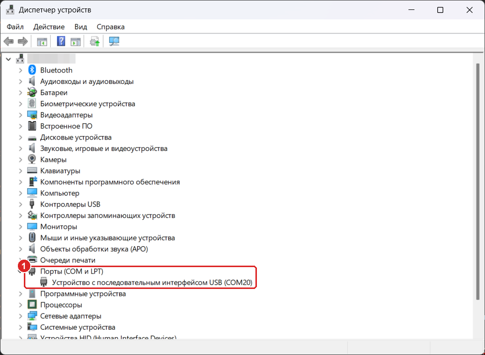

3. Напишите ассистенту:

   > Найди подключённые модемы Redbees.

   Ассистент вызовет `discover_devices` и покажет найденный модем: серийный
   номер, модель, версию прошивки.
4. Проверьте генерацию скриптов (модем для этого не нужен):

   > Напиши Lua-скрипт, который раз в минуту выводит уровень сигнала сотовой сети.

   Ассистент сначала покажет **план** скрипта и спросит, всё ли верно. Только
   после вашего согласия он напишет код и проверит его.

Если всё это сработало, сервер установлен и подключён правильно.

## 7. Как работать с сервером

**Пишите обычными словами.** Названия инструментов знать не нужно: ассистент
сам выбирает, что вызвать. Полезно указывать порт или адрес модема, если их
несколько.

Примеры запросов:

| Задача | Что написать |
|---|---|
| Найти модем | «Найди модемы» |
| Состояние модема | «Проведи диагностику модема на COM5» |
| Сигнал и сеть | «Какой уровень сигнала и есть ли регистрация в сети?» |
| Координаты | «Получи координаты GNSS с модема» |
| Журнал | «Покажи журнал модема за 30 секунд» |
| Настройка | «Поставь режим сети только LTE» |
| Новый скрипт | «Напиши скрипт, который опрашивает счётчик по Modbus RTU и отправляет данные по MQTT» |
| Проверить код | «Проверь этот Lua-скрипт: …» |
| Примеры | «Покажи примеры скриптов для Modbus» |
| Запустить скрипт | «Загрузи скрипт на модем и проверь, что он работает» |
| Обновить прошивку | «Обнови прошивку модема файлом D:/fw/app_smp.bin» |
| Разобрать сбой | «Модем сам перезагрузился, выясни почему» |
| Выгрузить данные | «Выгрузи временной ряд temp в CSV» |

### Безопасность: превью и подтверждение

Всё, что **меняет** модем (прошивка, запись настроек, загрузка и удаление
файлов, перезагрузка, отправка SMS, команды с действием), выполняется в два шага:

1. Сначала сервер возвращает **превью**: что именно будет сделано и чем это
   грозит. На этом шаге модем не затрагивается.
2. Ассистент показывает превью вам и спрашивает согласия. Только после вашего
   «да» он повторяет вызов с подтверждением, и действие выполняется.

Команды, которые только читают данные, выполняются сразу. Внимательно читайте
превью, особенно перед прошивкой и стиранием памяти. Эта защита работает в
любой программе-ассистенте, независимо от её собственных запросов разрешений.

Сервер также защищает модем от частых перезагрузок. После каждой загрузки
модем 120 секунд считается «на испытании». Если он несколько раз подряд не
доработал этот срок, загрузчик откатывается на заводскую прошивку. Поэтому
сервер откажется перезагружать модем, если счётчик неудачных загрузок уже
высокий, и предложит подождать.

### Долгие операции

Загрузка прошивки или тест скрипта могут длиться минутами. Если операция не
уложилась примерно в 40 секунд, сервер продолжает её в фоне и возвращает номер
задачи. Ассистент потом сам проверит результат (`job_status`). Если вызов
прервался по тайм-ауту, **не повторяйте операцию** сразу — попросите
ассистента проверить список фоновых задач.

### Советы

- Пока инструмент работает с COM-портом, не открывайте этот порт в других
  программах (PuTTY, Arduino IDE, монитор порта). Порт может использовать только
  одна программа одновременно.
- Если ассистент начал писать Lua-код «из головы», не вызвав `create_lua_script`,
  попросите: «Используй create_lua_script». Код, написанный без опоры на
  документацию прошивки, часто не работает.
- Слабые модели путаются, когда инструментов много. Если вам нужны только
  Lua-скрипты, добавьте к настройке `RB_TRANSPORT=stdio` ещё одну:
  `RB_TOOLSET=lua` (останется 8 инструментов) и перезапустите программу.

## 8. Подключение модема: USB, Bluetooth, сеть

Сервер связывается с модемом по протоколу SMP (mcumgr) тремя способами.

### USB (рекомендуется)

Достаточно номера порта (`COM5`, `/dev/ttyACM0`). Только по USB доступны журнал
консоли, тесты скриптов и прошивка через esptool.

### Bluetooth (BLE)

Модем виден под именем `RB-MODEM-XXXX`. Доступ защищён PIN-кодом из шести цифр;
у каждого модема он свой. PIN выдаёт поставщик или администратор парка (он
хранится в инвентарной таблице).

**На Windows** модем нужно один раз сопрячь средствами системы, потому что сам
сервер на Windows не умеет запрашивать PIN:

1. «Параметры» → «Bluetooth и устройства» → «Добавить устройство» → «Bluetooth».
2. Выберите `RB-MODEM-XXXX`, введите PIN и нажмите «Подключиться».
3. Дальше просто попросите ассистента: «Подключись к модему по Bluetooth».

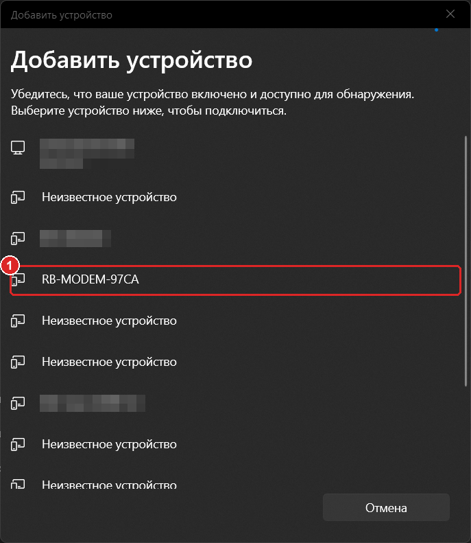
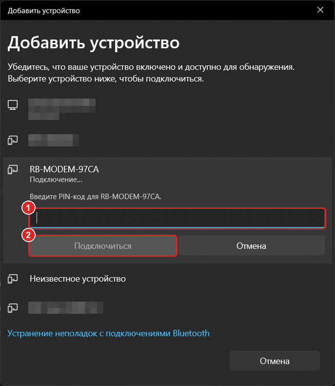

Если сервер сообщает `Insufficient Authentication`, значит Windows хранит старое
сопряжение без PIN. Удалите устройство в тех же настройках и сопрягите заново.

### Сеть (UDP с шифрованием DTLS)

Модем должен быть в сети и доступен с вашего компьютера по IP-адресу. Для
подключения нужны два значения: заводской серийный номер модема и ключ (PSK).
Их выдаёт администратор (на модеме их печатает команда `app_smp udp provision`).
Ключ — секрет: не пересылайте его в открытых каналах.

Ассистенту можно написать: «Подключись к модему 10.0.0.15 по UDP, серийный номер
123, ключ …». Ключ при этом уходит в облако вместе с запросом, поэтому удобнее и
безопаснее один раз задать его в настройках сервера (`RB_SMP_DTLS_PSK_ID`,
`RB_SMP_DTLS_PSK_HEX` рядом с `RB_TRANSPORT`, см. [раздел 13](#13-настройки-сервера)).

## 9. Список инструментов

Обозначения в колонке «Модем»:

- 👁 — только читает, ничего не меняет;
- ✋ — меняет модем, сначала показывает превью и ждёт вашего подтверждения;
- 📄 — не обращается к модему вообще (работает с документацией или файлами).

Названия инструментов нужны в основном для понимания, что делает ассистент:
программа показывает их, когда ассистент их вызывает.

### 9.1. Lua-скрипты

| Инструмент | Что делает | Модем |
|---|---|---|
| `create_lua_script` | Первый шаг создания скрипта: подбирает документацию и составляет **план** (подход, риски, вопросы к вам). Кода не пишет, ждёт вашего одобрения | 📄 |
| `implement_plan` | Второй шаг: пишет код по одобренному плану и проверяет его в несколько проходов | 📄 |
| `validate_lua_script` | Проверяет скрипт: синтаксис (настоящим интерпретатором Lua той же версии, что на модеме), правила прошивки, существующие функции API, опасные действия | 📄 |
| `query_documentation` | Ищет ответ в документации Lua API и примерах | 📄 |
| `list_api_channels` | Справка по внутренним каналам сообщений прошивки (модем, MQTT, LwM2M, CoAP, GPIO, порты и т.д.) | 📄 |
| `list_examples` | Список готовых примеров: приложения, библиотеки (Modbus, СПОДЭС, HART), карты регистров приборов, тесты | 📄 |
| `view_example` | Показывает текст выбранного примера | 📄 |
| `compress_context` | Сокращает длинный текст до нужного объёма, оставляя самое важное (служебный) | 📄 |

### 9.2. Поиск и опознание модема

| Инструмент | Что делает | Модем |
|---|---|---|
| `discover_devices` | Ищет модемы по USB, Bluetooth и сети и опознаёт каждый. Один модем, доступный несколькими способами, показывается один раз | 👁 |
| `list_serial_ports` | Список COM-портов компьютера, без подключения | 👁 |
| `scan_ble_devices` | Ищет модемы по Bluetooth | 👁 |
| `identify_device` | Опознаёт модем: серийный номер, модель, версии прошивки и загрузчика | 👁 |

### 9.3. Состояние, команды и настройки

| Инструмент | Что делает | Модем |
|---|---|---|
| `diagnose_device` | Полная диагностика за один вызов: система, здоровье, загрузчик, питание, модем, сигнал, SIM, GNSS, ключевые настройки, журнал | 👁 |
| `smp_shell` | Выполняет команду консоли модема. Команды чтения выполняются сразу, команды с действием — после подтверждения | 👁 / ✋ |
| `smp_shell_with_logs` | То же, но одновременно записывает журнал консоли (только USB) | 👁 / ✋ |
| `smp_settings` | Читает и меняет настройки модема (сеть, APN, порты, GPIO и т.д.). Изменение сразу применяется и сохраняется | 👁 / ✋ |
| `smp_stat` | Статистика модема по группам | 👁 |
| `smp_enum` | Какие группы команд SMP поддерживает модем | 👁 |
| `smp_os` | Системные действия: перезагрузка, дата и время, загрузка процессора и памяти, сведения о сборке | 👁 / ✋ |
| `shell_api_reference` | Справочник команд консоли | 📄 |
| `settings_api_reference` | Справочник настроек | 📄 |

### 9.4. Файлы и скрипты на модеме

| Инструмент | Что делает | Модем |
|---|---|---|
| `upload_lua_script` | Загружает скрипт на модем (по умолчанию `/scripts/main.lua`) | ✋ |
| `deploy_example` | Загружает готовый пример вместе с нужными ему библиотеками, каждый файл в свою папку | ✋ |
| `test_script_on_device` | Загружает скрипт по USB и читает журнал, чтобы увидеть, как он работает | ✋ |
| `run_lua_test` | Запускает тест на модеме: сохраняет текущие скрипты, запускает только тест, ждёт результата, затем возвращает всё как было (даже при сбое) | ✋ |
| `smp_fs` | Работа с файлами модема: список, загрузка, скачивание, удаление, создание папок, контрольные суммы | 👁 / ✋ |
| `ts_export` | Скачивает временной ряд, который ведёт скрипт, и сохраняет его в CSV на компьютере | 👁 |

### 9.5. Обновление прошивки по SMP

Обычный порядок: загрузить образ → применить → дождаться перезагрузки →
проверить → при ручном режиме подтвердить. Ассистент проведёт по шагам сам.

| Инструмент | Что делает | Модем |
|---|---|---|
| `compare_firmware` | Сравнивает файл прошивки с тем, что работает на модеме | 👁 |
| `smp_image` | Слоты прошивки: список, загрузка нового образа, стирание запасного слота | 👁 / ✋ |
| `smp_boot` | Управление обновлением: применить загруженный образ, подтвердить его, режим подтверждения (ручной или авто), откат на заводскую прошивку, состояние | 👁 / ✋ |
| `smp_wait_management_ready` | Ждёт, пока модем после перезагрузки снова будет готов к командам | 👁 |
| `smp_zephyr` | Полностью стирает раздел с настройками и файлами модема. **Необратимо** | ✋ |

### 9.6. Прошивка «с нуля» через esptool (только USB)

Нужна, когда модем не загружается или его прошивают впервые. Обычно для
обновления достаточно раздела 9.5.

| Инструмент | Что делает | Модем |
|---|---|---|
| `esptool_version` | Проверяет, что esptool доступен | 📄 |
| `flash_bootloader` | Записывает загрузчик (`bootloader.bin`) | ✋ |
| `flash_application` | Записывает приложение (`app.bin`) | ✋ |
| `flash_firmware` | Записывает произвольный файл по заданному адресу | ✋ |
| `erase_flash` | Полностью стирает память модема, включая загрузчик. **Необратимо** | ✋ |
| `hardware_reset_serial` | Аппаратный сброс по линиям USB-порта, когда модем не отвечает | ✋ |

### 9.7. Журналы и разбор сбоев

| Инструмент | Что делает | Модем |
|---|---|---|
| `read_serial_logs` | Читает журнал консоли модема по USB, с фильтрами | 👁 |
| `decode_coredump` | Расшифровывает сохранённый на модеме аварийный дамп: причина, адрес, стек вызовов | 👁 |
| `diagnose_silent_hang` | Для модема, который завис молча: перезапускает его в режим загрузчика и выясняет, где остановилась программа | ✋ |

### 9.8. Машинное обучение

| Инструмент | Что делает | Модем |
|---|---|---|
| `ml_check_model` | Проверяет модель `.tflite` перед загрузкой: подойдёт ли она прошивке, сколько памяти ей нужно | 📄 |
| `ml_boot_config` | Готовит значение настройки `ml`, чтобы модели загружались при старте модема | 📄 |

### 9.9. Фоновые задачи и служебное

| Инструмент | Что делает | Модем |
|---|---|---|
| `job_list` | Список фоновых задач | 📄 |
| `job_status` | Состояние и результат фоновой задачи | 📄 |
| `job_cancel` | Останавливает фоновую задачу (тест при этом всё равно вернёт модем в исходное состояние) | 📄 |
| `smp_version` | Версии библиотек связи с модемом | 📄 |

### 9.10. Парк модемов (для администраторов)

Эти инструменты появляются, только если администратор настроил **реестр
модемов** (`RB_FLEET_FILE`). Модем в них выбирается по имени из реестра; адрес и
ключ вводить не нужно.

Реестр — JSON-файл на компьютере с сервером, путь к нему задаёт `RB_FLEET_FILE`.
Ключи модемов лежат отдельно, в файле `<реестр>.keys.json` рядом с ним. Вручную
эти файлы писать не нужно: модемы добавляются из таблицы CSV командой

```bash
redbees-modem-mcp-fleet import modems.csv --dry-run   # проверить, ничего не записывая
redbees-modem-mcp-fleet import modems.csv             # добавить или обновить модемы
```

В таблице колонки `name,host,psk_id,psk`, по желанию ещё `udp_port`, `site` и
`tags` (теги через пробел):

```csv
name,host,psk_id,psk,udp_port,site,tags
pump-3,10.20.0.13,123456789,00112233445566778899aabbccddeeff,,Насосная 3,water north
```

`psk_id` и `psk` модем печатает командой `app_smp udp provision` (по USB, при
пусконаладке), `name` и `host` придумываете вы. Модем с новым именем
добавляется, с уже известным — обновляется. Ошибка в любой строке — и не
меняется ничего, а команда называет строку и причину. Работающий сервер видит
изменения со следующего вызова.

| Инструмент | Что делает | Модем |
|---|---|---|
| `fleet_list` | Список модемов из реестра | 📄 |
| `fleet_status` | Опрос нескольких модемов: на связи ли, сигнал, состояние прошивки | 👁 |
| `fleet_device_status` | Полная диагностика одного модема | 👁 |
| `fleet_shell` | Команда консоли на модеме | 👁 / ✋ |
| `fleet_settings` | Чтение и изменение настроек | 👁 / ✋ |
| `fleet_reboot` | Перезагрузка | ✋ |
| `fleet_upload_lua` | Загрузка Lua-скрипта | ✋ |
| `fleet_deploy_example` | Загрузка готового примера с библиотеками | ✋ |
| `fleet_firmware` | Обновление прошивки из каталога образов на сервере | 👁 / ✋ |

### Режимы набора инструментов

Набор инструментов задаёт настройка `RB_TOOLSET` (задаётся рядом с
`RB_TRANSPORT`):

| Значение | Что доступно | Для кого |
|---|---|---|
| `full` (по умолчанию) | Все инструменты из разделов 9.1–9.9 | Инженер с модемом на столе |
| `lua` | Только раздел 9.1 | Разработка скриптов без модема или со слабой моделью ИИ |
| `monitor` | Просмотр парка и справочники | Сервер мониторинга в сети |
| `manage` | Парк целиком и раздел 9.1 | Управление парком через облачный чат |

Режимы `monitor` и `manage` предназначены для серверов, к которым подключаются по
сети; их настраивает администратор. Модем в них выбирается только по имени из
реестра: адрес и ключ передать нельзя, поэтому ни направить сервер на чужой
модем, ни вытащить из него ключ через чат не получится. В `monitor` нет ни
одного инструмента записи. В `manage` нет команд, которые меняют или печатают
ключ модема, а прошивка ставится только из каталога `RB_FIRMWARE_DIR` на сервере,
по имени образа.

Пример запуска сервера для парка (Linux):

```bash
export RB_TOOLSET=manage RB_TRANSPORT=streamable-http RB_HOST=0.0.0.0 RB_PORT=8082
export RB_FLEET_FILE=/srv/acme/fleet.json
export RB_FIRMWARE_DIR=/srv/firmware            # только для manage
export RB_AUTH_CLIENTS=/srv/acme/clients.json   # токены пользователей
export RB_TLS_CERT=/etc/redbees/fullchain.pem RB_TLS_KEY=/etc/redbees/privkey.pem
export RB_AUDIT_LOG=/srv/acme/calls.jsonl       # журнал вызовов, по желанию
redbees-modem-mcp
```

**Токены.** На адресе, отличном от `127.0.0.1`, сервер без токенов не
запускается. Каждому пользователю выдаётся свой токен:

```bash
redbees-modem-mcp-token add ivanov --note "Иванов, диспетчерская"   # печатает токен один раз
redbees-modem-mcp-token list
redbees-modem-mcp-token revoke ivanov                                # токен перестаёт работать сразу
```

В файле хранится только хэш токена, поэтому потерянный токен не восстановить,
только выпустить заново. Программа-ассистент передаёт токен в заголовке
`Authorization: Bearer <токен>`. Все настройки — в [разделе 13](#13-настройки-сервера).

## 10. Справочники и готовые сценарии

Кроме инструментов, сервер отдаёт программе **документы** (ресурсы) и **готовые
сценарии** (prompts). Не все программы их показывают. Ассистент обращается к
документам сам, когда они нужны.

Документы:

| Адрес | Что это |
|---|---|
| `rbmodem://playbook` | Правила работы с модемом, которые сервер даёт ассистенту |
| `rbmodem://lua-guide` | Руководство по написанию Lua-скриптов |
| `rbmodem://lua-api` | Справочник Lua API прошивки |
| `rbmodem://shell-api` | Справочник команд консоли |
| `rbmodem://settings-api` | Справочник настроек |
| `rbmodem://fieldbus` | Драйверы промышленных шин: Modbus, СПОДЭС, HART |
| `rbmodem://ml-requirements` | Требования к моделям машинного обучения |
| `rbmodem://firmware-notes` | Версия прошивки, которой соответствует документация |

Сценарии:

| Сценарий | Что делает |
|---|---|
| `write_lua_script` | Создать скрипт по описанию задачи |
| `deploy_lua_script` | Создать скрипт и загрузить его на модем |
| `device_checkup` | Проверить состояние модема |
| `firmware_update` | Безопасно обновить прошивку |

## 11. Обновление и удаление

Сервер не обновляется сам. Чтобы поставить новую версию:

```bash
uv tool upgrade redbees-modem-mcp
```

После этого перезапустите программу-ассистент: она запустит уже новую версию
сервера.

Удалить сервер:

```bash
uv tool uninstall redbees-modem-mcp
```

Поисковая модель остаётся в папке `~/.cache/redbees-modem-mcp`; её можно удалить
вручную. Не забудьте убрать сервер и из настроек программы-ассистента.

## 12. Если что-то не работает

| Что происходит | Что делать |
|---|---|
| Установка сервера обрывается на `python-mbedtls` | uv взял Python 3.13 или новее. Переустановите с Python 3.12: `uv tool install --python 3.12 --reinstall redbees-modem-mcp` |
| `uv: команда не найдена` | Закройте и снова откройте терминал. Не помогло — перезагрузите компьютер |
| Программа пишет, что не нашла `redbees-modem-mcp` | Полностью закройте программу (в том числе значок в области уведомлений) и запустите снова: она могла быть открыта до установки сервера. Не помогло — укажите вместо `redbees-modem-mcp` полный путь: `C:/Users/<ваше имя>/.local/bin/redbees-modem-mcp.exe` (Windows) или `~/.local/bin/redbees-modem-mcp` (Linux, macOS) |
| Сервер не подключается по тайм-ауту | Выполните шаги 2 и 3 [установки](#3-установка-сервера) в терминале и дождитесь конца. В Codex и Kimi Code проверьте время на запуск в файле настроек, как описано в их разделах |
| Ошибка «Недостаточно места на диске» при установке | Освободите около 3 ГБ на системном диске и повторите |
| Модем не находится по USB | Проверьте кабель (некоторые кабели только для зарядки) и «Диспетчер устройств». На Linux — [шаг 4](#шаг-4-только-linux-разрешите-доступ-к-usb-порту) установки |
| «Порт занят», `PermissionError`, `Access denied` | Закройте другие программы, которые открыли этот порт (терминалы, мониторы порта) |
| Модем не находится по Bluetooth | Проверьте, что Bluetooth включён. На Windows откройте список устройств Bluetooth в параметрах, это «будит» адаптер |
| `Could not pair with device` или `Insufficient Authentication` | Сопрягите модем через параметры Windows с PIN-кодом, см. [раздел 8](#bluetooth-ble) |
| Операция прервалась по тайм-ауту | Не повторяйте её. Попросите ассистента: «Проверь фоновые задачи» |
| Ассистент пишет `SEMANTIC RAG UNAVAILABLE` | Не загрузилась поисковая модель. Выполните `redbees-modem-mcp-download-model` и перезапустите программу |
| Модель не вызывает инструменты или вызывает не те | Выберите более сильную модель или включите `RB_TOOLSET=lua`, если нужны только скрипты |
| `WinError 1114` при запуске (`Error loading "...c10.dll"`) | Установилась версия PyTorch для видеокарт NVIDIA, а она конфликтует с гибридной графикой или энергосбережением Windows. Переустановите сервер: `uv tool install --python 3.12 --reinstall redbees-modem-mcp` |
| Сервер падает при поиске по документации или пишет `SEMANTIC RAG UNAVAILABLE` на Windows | Проверьте, что `RB_OMP_THREADS` не задан или равен `1` |
| Сервер предупреждает, что прошивка модема старее 0.10.1 | Часть команд может отличаться. Обновите прошивку модема или учитывайте это |

## 13. Настройки сервера

Все настройки сервера — переменные окружения. Обязательных нет: у каждой есть
значение по умолчанию. Где их задавать:

- **stdio** (подразделы 5.1–5.6) — в настройках программы-ассистента, рядом с
  `RB_TRANSPORT`: в блоке `env` (Claude Code, Kimi Code), `environment`
  (OpenCode), в поле переменных окружения (ADCode, Codex, ZCode);
- **HTTP** ([подраздел 5.7](#57-режим-http-один-сервер-на-все-программы)) — в
  команде запуска сервера, как `RB_PORT` в примере.

| Переменная | По умолчанию | Назначение |
|---|---|---|
| `RB_TRANSPORT` | `stdio` | Режим работы: `stdio`, `streamable-http` или устаревший `sse` |
| `RB_HOST` | `127.0.0.1` | Адрес для HTTP-режима. Любой адрес, кроме `127.0.0.1`, требует `RB_AUTH_CLIENTS` или `RB_AUTH_TOKEN` |
| `RB_PORT` | `8082` | Порт для HTTP-режима |
| `RB_AUTH_CLIENTS` | — | Файл токенов пользователей (хранятся хэши; управление — `redbees-modem-mcp-token`). Перечитывается при изменении |
| `RB_AUTH_TOKEN` | — | Один общий токен на всех, не короче 32 символов. Каждый запрос должен нести `Authorization: Bearer <токен>`, иначе ответ 401 |
| `RB_TLS_CERT` / `RB_TLS_KEY` | — (выкл.) | PEM-файлы сертификата и ключа: заданы оба — сервер работает по HTTPS, не задан ни один — по HTTP. Задан только один — сервер не запускается |
| `RB_AUDIT_LOG` | — (выкл.) | Файл журнала вызовов инструментов: JSON-строка на вызов, без вывода устройств и секретов |
| `RB_SESSION_IDLE_TIMEOUT` | `0` (выкл.) | Через сколько секунд простоя закрывать HTTP-сессию. Имеет смысл (например, `3600`) на сервере, который работает сутками |
| `RB_TOOLSET` | `full` | Набор инструментов: `full`, `lua`, `monitor` или `manage`, см. [«Режимы набора инструментов»](#режимы-набора-инструментов) |
| `RB_FLEET_FILE` | — | Реестр модемов (JSON). Обязателен для `monitor` и `manage`; в `full` добавляет инструменты `fleet_*` |
| `RB_FLEET_KEYS` | `<реестр>.keys.json` | Файл ключей модемов; его пишет `redbees-modem-mcp-fleet import` |
| `RB_FIRMWARE_DIR` | — | Каталог образов прошивки для `fleet_firmware` (`manage`) |
| `RB_FLEET_CONCURRENCY` | `8` | Сколько модемов парка опрашивается одновременно |
| `RB_FLEET_CONNECT_TIMEOUT` | `8.0` | Секунды на подключение к модему парка; столько стоит каждый недоступный модем |
| `RB_SMP_DTLS_PSK_ID` | — | Заводской серийный номер модема для подключения по сети (UDP), десятичной строкой |
| `RB_SMP_DTLS_PSK_HEX` | — | Ключ (PSK) этого модема, hex. Это секрет |
| `RB_SMP_TIMEOUT` | `5.0` | Секунды на один запрос к модему |
| `RB_SERIAL_WRITE_TIMEOUT` | `5.0` | Секунды на запись в COM-порт (защита от зависшего или выдернутого порта) |
| `RB_JOB_FOREGROUND_WAIT` | `40` | Сколько секунд долгая операция ждёт результата, прежде чем уйти в фон. Должно быть меньше времени ожидания программы-ассистента |
| `RB_LOG_DIR` | временная папка | Куда `run_lua_test` сохраняет полный журнал консоли |
| `RB_MODEL_NAME` | `jina-code-embeddings-0.5b` | Поисковая модель. Менять не нужно: база знаний собрана именно ей |
| `RB_MODEL_DIR` | кэш | Папка поисковой модели (полный путь). Если модели там нет, она скачается |
| `RB_HF_REPO_ID` | `jinaai/<RB_MODEL_NAME>` | Откуда скачивать поисковую модель |
| `HF_TOKEN` | — | Токен HuggingFace, если скачивание модели требует входа |
| `RB_VECTOR_DB_DIR` | встроенная | Папка базы знаний |
| `RB_EXAMPLES_DIR` | встроенная | Папка Lua-примеров и справочников |
| `RB_DOC_TOKEN_BUDGET` | `6000` | Сколько документации (в токенах) сервер отдаёт модели за раз |
| `RB_OMP_THREADS` | `1` | Потоки процессора для поиска. **На Windows держите `1`**: больше может уронить сервер |

## 14. Словарь терминов

| Термин | Значение |
|---|---|
| **MCP** | Model Context Protocol — стандарт подключения внешних программ к ИИ-ассистентам |
| **Программа-ассистент (MCP-хост)** | Программа, в которой вы общаетесь с моделью и которая запускает MCP-серверы |
| **MCP-сервер** | Программа, которая даёт ассистенту инструменты |
| **Инструмент (tool)** | Одно действие сервера, которое может вызвать ассистент |
| **LLM** | Большая языковая модель — «мозг» ассистента |
| **Терминал** | Окно для ввода команд: PowerShell на Windows, «Терминал» на Linux и macOS |
| **Превью** | Описание действия до его выполнения; модем при этом не меняется |
| **SMP (mcumgr)** | Протокол управления модемом: команды, файлы, настройки, прошивка |
| **COM-порт** | Имя USB-подключения модема в системе (`COM5`, `/dev/ttyACM0`) |
| **BLE** | Bluetooth Low Energy — беспроводное подключение к модему |
| **Сопряжение (pairing)** | Однократная привязка модема к компьютеру по Bluetooth с вводом PIN |
| **DTLS, PSK** | Шифрование сетевого подключения и общий секретный ключ для него |
| **Слот прошивки** | Область памяти модема с образом прошивки; новый образ загружается в запасной слот |
| **Подтверждение образа** | Отметка, что новая прошивка работает; без неё модем откатится на прежнюю |
| **Coredump** | Аварийный дамп: что делала прошивка в момент сбоя |
| **esptool** | Программа для прошивки чипа ESP32 модема по USB |
| **Фоновая задача (job)** | Долгая операция, которая продолжается после ответа инструмента |
| **Окно контекста** | Сколько текста модель может учитывать за раз |

## Лицензия

[Apache-2.0](https://github.com/dmkuzmin/redbees-modem-mcp/blob/main/LICENSE).
